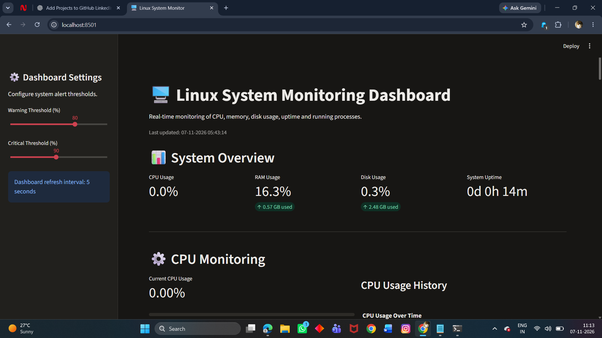
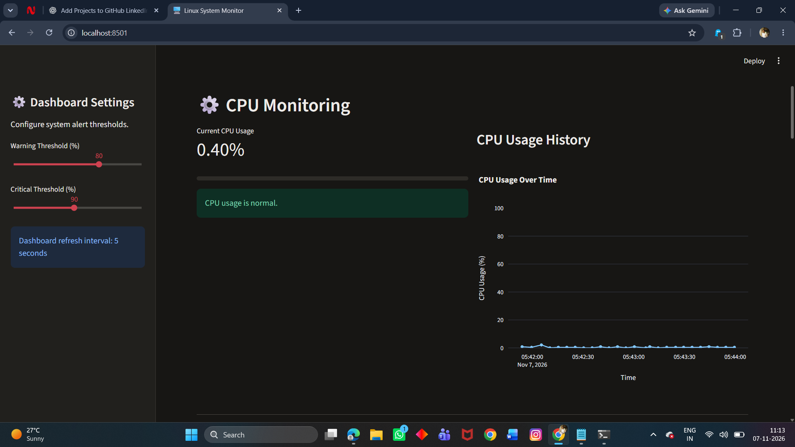
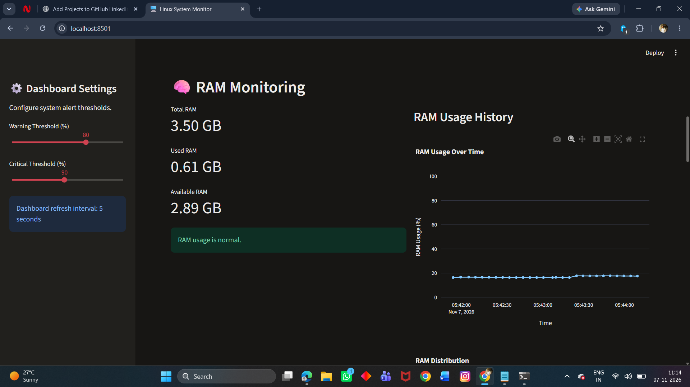
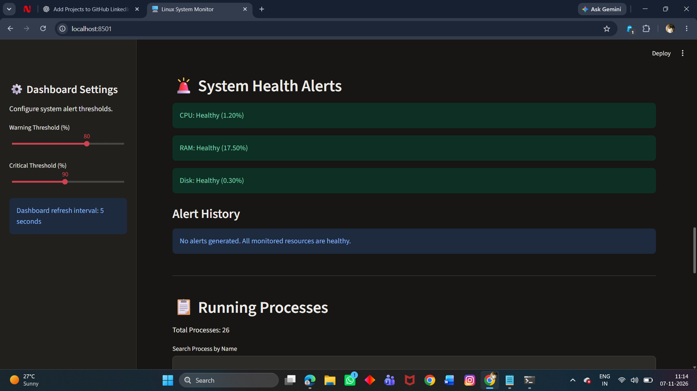
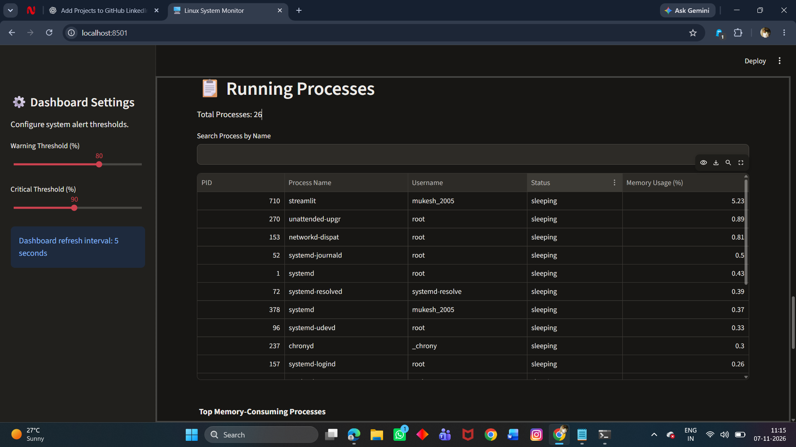

# Linux System Monitoring Dashboard

A real-time Linux system monitoring dashboard built with Python,
Streamlit, and Psutil. It helps monitor CPU usage, memory usage, disk
space, system uptime, running processes, and system health alerts
through a web interface.

The project was developed and tested in Ubuntu on WSL2. On WSL2,
resource readings represent the Ubuntu environment and may differ from
Windows Task Manager.

## Features

- Automatic dashboard refresh every 5 seconds.
- CPU usage monitoring and history chart.
- RAM usage monitoring and history chart.
- Disk space and disk usage monitoring.
- System uptime display.
- Running process monitoring.
- Search and filter running processes.
- Configurable warning and critical thresholds.
- System health status for CPU, RAM, and disk.
- Alert history in the dashboard.
- CSV export for alert history.
- CSV export for CPU, RAM, and disk metrics.
- CSV export for process information.

## Screenshots

### Dashboard Overview



### CPU Metrics History



### RAM Metrics History



### System Health Alerts



### Process Monitoring



## Technologies Used

- Python
- Linux / Ubuntu
- WSL2
- Streamlit
- Streamlit Autorefresh
- Psutil
- Pandas
- Plotly
- Git and GitHub

## Project Structure

```text
linux-system-monitor/
├── app.py
├── cpu_monitor.py
├── memory_monitor.py
├── disk_monitor.py
├── process_monitor.py
├── health_check.py
├── requirements.txt
├── README.md
├── .gitignore
├── images/
│   ├── dashboard_overview.png
│   ├── CPU metrics_history.png
│   ├── RAM metrics_history.png
│   ├── system_alerts.png
│   └── process_monitoring.png
└── venv/
```

The `venv/` directory is a local virtual environment and should not be
committed to GitHub.

## Requirements

- Python 3
- Ubuntu or another Linux distribution
- pip
- Git

## Installation and Setup

### 1. Clone the repository

```bash
git clone https://github.com/KURUCHETI-MUKESH/linux-system-monitoring-dashboard.git
cd linux-system-monitoring-dashboard
```

### 2. Create a virtual environment

```bash
python3 -m venv venv
```

### 3. Activate the virtual environment

```bash
source venv/bin/activate
```

### 4. Install dependencies

```bash
pip install -r requirements.txt
```

If you need to install the packages manually, use:

```bash
pip install psutil streamlit streamlit-autorefresh plotly pandas
```

## Run the Dashboard

From the project directory, with the virtual environment activated, run:

```bash
streamlit run app.py
```

Open the local address shown in the terminal. It is usually:

```text
http://localhost:8501
```

## Run the Individual Monitoring Scripts

Run these scripts independently from the project directory:

```bash
python cpu_monitor.py
python memory_monitor.py
python disk_monitor.py
python process_monitor.py
python health_check.py
```

The Streamlit dashboard is started separately with
`streamlit run app.py`.

## Health Alerts

The standalone health checker uses these thresholds:

- **Warning:** resource usage is above 80%.
- **Critical:** resource usage is above 90%.

It can write alerts to `health_alerts.log` when a threshold is exceeded.
The dashboard also displays health status and alert history.

## CSV Reports

The dashboard provides download controls for:

- System metrics (CPU, RAM, and disk).
- Alert history.
- Running process information.

Metric and alert history is maintained in the active Streamlit session.
It is not stored in a permanent database and may reset when the app or
session restarts.

## Notes

- On WSL2, resource readings may not match Windows Task Manager
  exactly.
- Keep the `venv/` directory out of Git commits.
- The screenshot links above depend on the exact filenames in the
  `images/` folder. If a filename changes, update its README link too.

## Author

**Kurucheti Mukesh**

GitHub: [KURUCHETI-MUKESH](https://github.com/KURUCHETI-MUKESH)

## License

This project is shared for learning and portfolio purposes. Add a formal
license file if you want to define reuse and distribution permissions.
